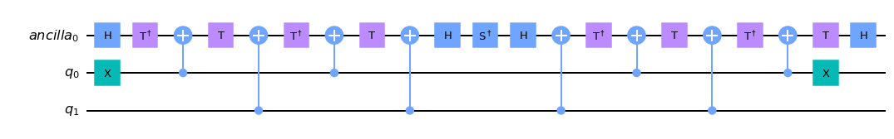
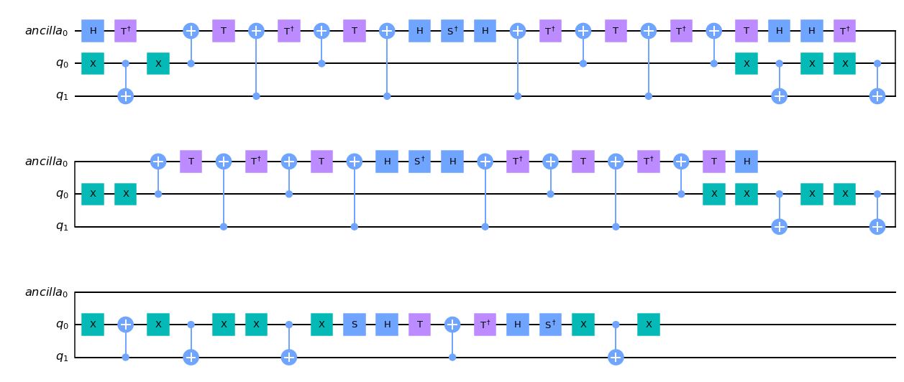

# Exact synthesis of multiqubit Clifford+T circuits

This Python implementation takes a unitary matrix with entries in the Clifford+T ring and synthesizes a matching quantum circuit. It reduces the matrix into one- and two-level operations, then decomposes those operations into Clifford+T gates using the method in [Exact synthesis of multiqubit Clifford+T circuits](https://arxiv.org/abs/1212.0506).

## Run the tests

Install NumPy, SymPy, Jupyter Notebook, Qiskit, and `qiskit_textbook`. The code uses the older `qiskit.extensions` and `qiskit.Aer` APIs, so use a Qiskit release that provides them. From the repository root, run:

```bash
jupyter notebook Test.ipynb
```

Run the notebook cells to generate a unitary, synthesize its circuit, and compare their matrices. You can also browse the [saved test results](tests/index.html).

## Example 1

[Test 1](tests/Test_1.html) synthesizes this two-qubit unitary:

$$
U = \begin{bmatrix}
1 & 0 & 0 & 0 \\
0 & -i & 0 & 0 \\
0 & 0 & 1 & 0 \\
0 & 0 & 0 & 1
\end{bmatrix}
$$

The saved output reports `True` for the circuit comparison and 23 Clifford+T gates:



## Example 2

[Test 2](tests/Test_2.html) uses another two-qubit matrix with off-diagonal entries:

$$
U = \begin{bmatrix}
-\frac{i}{\sqrt{2}} & 0 & 0 & -\frac{i}{\sqrt{2}} \\
0 & 1 & 0 & 0 \\
0 & 0 & 1 & 0 \\
\frac{i}{\sqrt{2}} & 0 & 0 & -\frac{i}{\sqrt{2}}
\end{bmatrix}
$$

Its saved output reports `True` for the circuit comparison and 76 Clifford+T gates:


